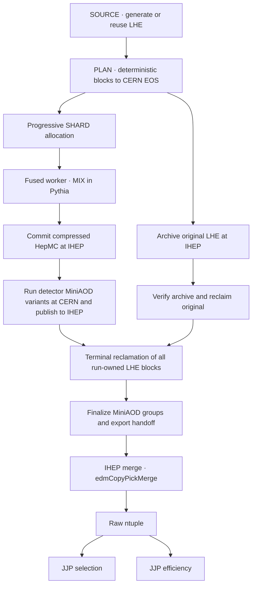

# Production-core architecture

The refactor separates physics execution, production planning, scheduler access,
and operator-facing commands. It uses a model/controller/CLI split rather than a
web-style MVC framework. The new worker, allocation, handoff, batch, aggregation,
CERN controller, and DAG rendering contracts are implemented and covered by
offline tests. Live scheduler, storage, and full physics runtime validation still
remain before production cutover.

## Code and production records

```text
production-wrapper/                 separate repository
  core/                             pinned production-core submodule
  campaigns/                        operator-owned run specifications
  history/                          production decisions and completed-run records
  work/                             ignored, submit-visible generated jobs
  runtimes/                         ignored, reusable runtime releases

production-core/
  mcprod                            CLI entry point
  src/full_mc/
    domain/                         counts, source identities, deterministic allocation
    planning/                       DAG construction and offline capacity estimates
    application/                    run lifecycle, handoff, recovery, aggregation
    backends/                       scheduler-specific submission and status
    runtime/                        explicit profiles, packaging, worker bootstrap
    storage/                        exact URLs, transfers, archive operations
    workers/                        LHE, PLAN, MIX, MiniAOD, merge, ntuple, analysis
  common/campaigns/                 physics campaign catalogue
  common/cmssw_configs/             campaign-layer CMSSW configurations
  docs/                             durable operator and developer instructions
```

The wrapper is the intended home for incremental production history, and its
initializer is implemented. Migration of existing history and creation of the
operator's production wrapper remain separate activities. Counted inventories
and selected source IDs remain authoritative. Inventory/job-spec checksums belong at the
planning boundary, not in repeated worker package validation.

## CERN campaign-shard DAG



Campaign SHARDs allocate progressively from accepted PLAN segments. The
allocator freezes source/slot block identities, stride and offset, RNG seeds,
and EDM IDs. A SHARD can start while SOURCE archiving is underway. When all
SOURCE and SHARD nodes are complete, one terminal reclaim worker per pool
removes every block named by that run's accepted PLAN receipts. Finalization
requires an accepted reclaim result for every pool.

Selection and efficiency each read the full raw ntuple and have independent
checkpoints. JUP uses merge and ntuple.

## Runtime and transfer boundaries

| Stage | Runtime profile | Persistent product |
| --- | --- | --- |
| LHE generation | `helac-el7` | compressed LHE |
| Block planning | `utilities-el9` | compressed blocks; one task result |
| Shower and mixing | `pythia-el8` | compressed HepMC checkpoint at IHEP T2 |
| MiniAOD | `cmssw12-sim-el8` | component MiniAOD at IHEP |
| Merge | `cmssw12-sim-el8` | merged MiniAOD checkpoint |
| Ntuple | `cmssw15-ntuple-el9` | full raw ntuple checkpoint |
| Selection/efficiency | `analyzer-el9` | selected ROOT / parquet shard archive |

Profiles are declared by stage; host OS detection must not choose physics
software. Native scripts currently remain behind narrow stage adapters while
their responsibilities are migrated. The two-CPU MiniAOD stage retains the
native two-thread CMSSW settings.

`mcprod runtime prepare` creates an allowlisted code bundle and separate heavy
assets. It does not walk the generated directory, inventories, campaign job
specs, or Git data. Heavy packages are prepared once per runtime release, not
copied into every node directory. The transfer bootstrap unpacks the selected
profile assets and executes the bundled CLI in a new Python process. A fused
job runs the native MIX and simulation commands in their declared profiles
sequentially and shares one local HepMC across variants.

Each worker gets one task JSON. Source slots contain only that task's block
references and their exact URLs. For example, a MIX task's slot configuration is:

```json
{
  "slot": 0,
  "inputs": ["BLOCK:pool_jpsi_CSCO_g:source9:000003"],
  "mode": "normal",
  "rng_seed": 12345,
  "target_hepmc_events": 100,
  "max_lhe_events": 1000
}
```

The allocator freezes the seed; workers do not derive it from scratch paths.
Source-slot HepMC is scratch-only. MIX publishes the actual accepted count, not
the requested target. MiniAOD and merge use actual `edmFileUtil` counts. Native
HELAC diagnostic stageouts are disabled in the new adapter; only declared
products are published by the core transfer layer.

## Storage and recovery

CERN EOS retains run-owned PLAN blocks and originals awaiting verified source
archiving. The fused worker publishes mixed HepMC directly to its run-owned
IHEP archive path and MiniAOD directly to its existing product paths. The v3
state transaction records accepted receipts, PLAN segments, allocations, and
completion under a dedicated lock. It has no resident-byte counters, producer
reservations, or intermediate cleanup state.

Each fused artifact has checksum-addressed candidate metadata, an exclusive
persist-on-successful-close payload, and a final JSON record. Validation binds
those records to the frozen processing task, runtime release and core revision,
counts, byte size, and Adler-32 checksum. MiniAOD metadata also binds each
variant to the exact HepMC checkpoint. A retry can finish a payload whose final
JSON publication was interrupted. A retry with committed outputs can verify and
return success without invoking native physics commands.

The immutable group ledger plus `state.json`'s committed
`merge_group_counts` are the authoritative state source. Handoff export reads
those committed records, materializes `merge_groups.json` as a derived operator
snapshot, and checks component MiniAODs rather than the future merge output.
`handoff.json` is the formal downstream interface and carries actual event
counts into the IHEP task. Batch preparation uses job-private proxy and scratch
paths and distinct checkpoint directories. Submission attempts are persisted
before contacting HepJob; ambiguous or interrupted attempts require exact
reconciliation and are not automatically duplicated.

## Remaining integration

The refactored CLI is the supported interface for new work. Prepared pilots,
live CERN/IHEP scheduler reconciliation, full analyzer execution, and the
CMSSW15 fallback still require environment validation before production cutover.
Use the v3 worker, state, and controller together. Historical runs keep their
frozen runtime and matching Git revision. See [historical operations](legacy-production.md).

Offline checks for the current contracts:

```bash
PYTHONPATH=src python3 -m unittest \
  tests.test_core_workers tests.test_core_ihep tests.test_core_analysis \
  tests.test_core_planning tests.test_core_planner_local tests.test_core_handoff \
  tests.test_core_workspace
```
