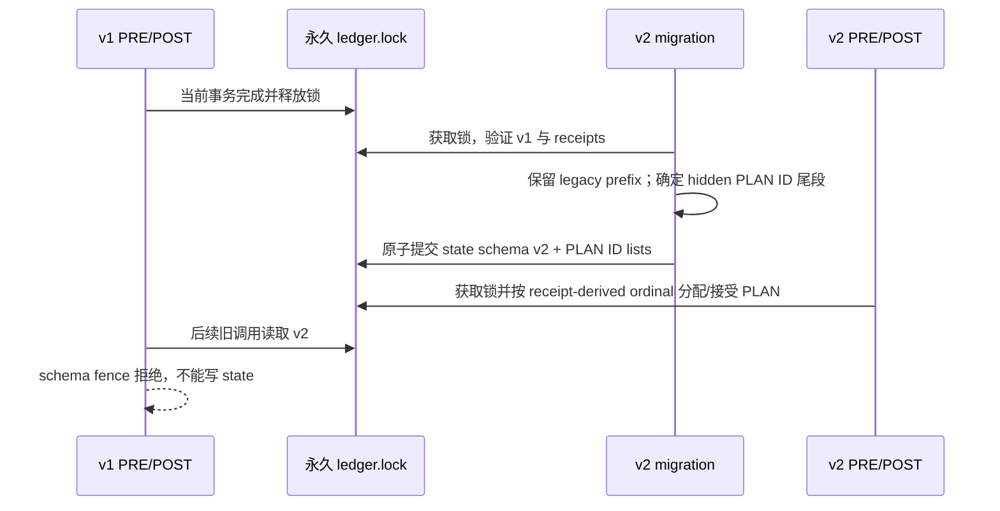

# v06_01 追加式 PLAN 库存索引与热切换设计

日期：2026-10-30
状态：prototype 与离线 rehearsal 已完成；parent/independent review 未发现正确性缺陷；相关回归/fault suites 通过。新 migration path 的 AFS durability rehearsal、旧 writer drain 与真实 run 热切换仍待验收。
基线：隔离 worktree `.worktrees/v06_01-append-only-inventory`，branch `feat/v06_01-append-only-inventory`，HEAD `fdce0e9b9fd1f4b866174800d7101801572df956`。该 worktree 带有 dirty v06_01 staging/controller overlay；本文引用现有源码行为时指该快照。历史审计报告：`/tmp/chiw/append_inventory_history.md`；workspace provenance：`/tmp/chiw/append_inventory_workspace.md`。

## 结论

**设计方向：YES。按下述限制实现 append-only PLAN ID list 是合理的。** 它可把 PLAN 的 pool membership 与 append 顺序固化在 state 中，避免每次按 `spec` 和 accepted markers 重新发现顺序，并允许较晚 source 的已接受 PLAN 先进入该 pool 的 PLAN ID list 尾部。为了提供 allocator 所需的 artifact refs，receipt 读取及 block 列表 materialization 仍是 O(visible PLAN receipts + blocks)；当前没有证据证明整体提速。

**运行中切换：CONDITIONAL。** schema fence、迁移恢复、分配/回收回归和独立 code review 已通过；cache-only benchmark 没有显示可靠提速。切换仍要求先部署保持 v1 的兼容 runtime、证明旧 PRE/POST writer 已 drain、确认新 migration path 的 AFS replace/fsync durability 与操作窗口，实际迁移由 operator 另行人工确认。

**当前生产切换判断：CONDITIONAL。** 本文仅记录设计和离线证据，本轮未部署或迁移生产 run。技术条件是实现 review、旧 writer drain、migration checkpoint、v2 replace/fsync durability 证据与获批操作窗口；实际迁移另行人工确认。

## 1. 现状与历史取舍

当前实现（`src/full_mc/application/shards.py:244-266`）每次从 `spec["sources"]` 顺序扫描 source。对每个 pool，它跳过明确标记为 `skipped` 的 source；遇到第一个 PLAN 尚未进入 `state["accepted"]` 的 source，就停止该 pool 的扫描。已接受 source 的 PLAN outputs 按 receipt 顺序平铺，并以 `len(blocks[pool])` 作为 pool 内 `SourceBlock.index`。只有所有非 skipped source 的 PLAN 都 accepted，pool 才标记 exhausted。

这个连续前缀规则保证后完成的 PLAN 不会挤到一个此前未知的较早 source 前面。它也让 `blocks[index]`、stride/offset、`may_still_need()` 和 cleanup 使用同一种 pool 物理位置。代码目前没有持久保存每个 block 的 pool ordinal；ordinal 是由 source 顺序和 PLAN output 顺序重新推导的。

代价是 `_inventory()` 仍要读取 PLAN receipt 并构建 allocator 所需的 block/ref 容器；PLAN ID list 不存 receipt 内容。它可能减少按 `spec`/accepted marker 发现 membership/order 的工作，但不会改变 receipt/output materialization 的渐进复杂度。当前没有生产时延/读量或完成时间基准。另一个现有限制是 `complete_shard()` 只让连续完成的 allocation 前缀推进 `safe_cursor`（`shards.py:743-770`），因此早期慢 shard 可能延迟后续已完成 shard 的输入回收。

所列提交的历史含义如下：

| 提交 | 直接历史证据 | 对本设计的意义 |
|---|---|---|
| `04142b1f41` `Add inventory-driven recovery production workflows` | 修改 legacy `dag_generator.py`、LHE planner/coordinator、DAG progress 和测试。 | 是旧工作流的 inventory/recovery，不是当前 `src/full_mc/domain` shard index 的直接祖先。可参考精确 inventory 的外部约束，不能据此推导 v06 的 ordinal 格式。 |
| `717b05de5a` `Snapshot-isolate retry manifests...` | 修改 `tools/split_workflow.py`，避免重审 manifest 改变 in-flight job indices。 | 支持冻结身份/manifest 的一般原则，不是 v06 inventory 演进。 |
| `e1fdf487a5` `Make the mcprod wave seam local-only...` | 增加 reclaim worker 与 storage reclaim 协议，把删除移到 worker，凭精确结果 settlement 释放 ledger 容量。 | 可复用“可回收候选”与“确认已删除并释放容量”分开的协议；不能因索引命中就直接释放容量。 |
| `32bd71c42e` `Implement isolated campaign shard scheduler and staging ledger` | 引入 `application/shards.py`、`application/staging.py`、`domain/streams.py` 和 `domain/inventory.py`，以及对应测试。 | 当前连续 accepted PLAN 前缀、campaign-local 游标、staging ledger 和 cleanup predicate 的主来源。 |
| `f5321c3` `Add staged HELAC sweep and global shard identity` | 增加 global job identity 并用于 seed/EDM identity。 | 冻结的 allocation/physics identity 必须原样保留；不意味着跨 run 必须得到相同的新 block 分配。 |

## 2. A/B/C 方案比较与选型

| 方案 | 表示方式 | 优点 | 成本与风险 | 判断 |
|---|---|---|---|---|
| A. 连续平铺数组（现状） | 每次把 accepted contiguous prefix 转成 `blocks[ordinal]`。 | 简单；ordinal 随机访问 O(1)；exhaustion 与空缺语义直观；已冻结的 allocator/cleanup 直接消费。 | 重复扫描 receipts、构建列表和 ref map；成本随 accepted inventory 增长。没有历史基准量化。 | 保留为 v1 与迁移基线。 |
| B. append-only PLAN ID list（本设计） | 每个 pool 保存有序 PLAN task ID 列表；列表顺序定义 PLAN ID list 顺序，PLAN ID list 中各 receipt 的 block ordinals 从各 receipt 输出数的前缀和派生。**迁移后，新 PLAN ID 按被 ledger 接受的事务顺序追加。** | 新 PLAN 只向 pool 的 ordered PLAN task ID list 追加一个 ID；既有 ordinal 不移动；消费者通过 receipt output count 的前缀和定位 ordinal；可复用 stream 和 cleanup 证明。 | 要原子记录接受顺序和 PLAN ID；处理 legacy hidden accepted receipts、重复 POST、崩溃恢复和旧 runtime 拒写。receipt 读取与 block materialization 仍是 O(visible blocks/receipts)，整体收益待测。 | 推荐，条件是 schema fence 与迁移协议完成。 |
| C. sparse map/index | 只保留稀疏 ordinal、仍可用 blocks 或 artifact-key 映射，可能省略已回收位置。 | 大库存、回收比例高时有潜在内存/遍历收益。 | 缺少的 index 可能代表未接受的未知尾部、已回收历史 block、stream 不消费的 ordinal 或真正空洞；破坏 dense-sequence 假设风险高。cleanup/恢复须另设每块消费覆盖证明。 | 不纳入 v06_01 首轮；不应与 B 捆绑。 |

### B 的顺序规则（明确修订）

B 不要求迁移后仍按 `spec["sources"]` 顺序加入新 PLAN，也不要求不同 run 得到相同的新 block 分配。正确性需要的是**ordinal 稳定且提交顺序被持久化**：

1. 迁移开始时，按 v1 算法重建每个 pool 已经暴露的 legacy contiguous prefix，并原封不动地保留其 ordinal。
2. state 中已经 accepted、但因前面 source 未完成而被 v1 隐藏的 PLAN receipts，没有旧 ordinal。为确定迁移结果，先按 source index 排序，将其 task IDs 追加到 legacy prefix 后的 pool 列表。该顺序只用于一次迁移，不移动 legacy prefix。
3. v2 生效后，每个之后新接受的 PLAN，在接受事务里把 task ID 追加到该 pool 的有序列表尾；其新 ordinals 由此前 receipt output counts 的总和得出。顺序即 ledger 接受事务的 commit order。该 PLAN ID append 不可被后续 source 插到前面。
4. 同一 PLAN ID 对应的 receipt 内保留 PLAN receipt 的 output 顺序。这样单个 PLAN 的 block 顺序及物理 ordinal 固定；跨 run 对未来 source 的 PLAN ID 排序相同不属于要求。
5. `state["accepted"]` 不能作为 commit-order 来源：它只记录 accepted marker，state JSON 按 key 排序写盘，字典顺序不是可靠的接受日志。接受顺序必须由 PLAN ID list 中的位置本身在同一个事务中保存。

“source 顺序”只在 v1 ordinal 的重建和迁移时 hidden accepted PLAN IDs 的一次性定序中保留。源码中其他按 `spec["sources"]` 的循环（例如 source task identity、每 pool 的 admission 次序和容量估算）服务于各自任务身份/调度行为，不要求新 PLAN block ordinal 按 source order。明确依赖 block ordinal 的位置是 `_inventory()`、allocator 的 `blocks[index]`（`domain/streams.py:116-118`）和 cleanup 的 `may_still_need(block.index, stream)`（`shards.py:778-797`）。

## 3. 最小状态模型

下面是已实现且经离线测试的最小持久表示；每个 pool 只存有序 PLAN task ID 列表，路径为 `state["planner"]["inventory_segments"]["pools"][pool]`，不额外持久化来源映射或 ordinal/count。

```json
{
  "state_schema": "mcprod-shard-state-v2",
  "planner": {
    "inventory_segments": {
      "schema": "mcprod-plan-inventory-v1",
      "pools": {
        "pool-a": ["PLAN_000000", "PLAN_000004", "PLAN_000007"]
      }
    }
  }
}
```

- 每个列表元素是对应 pool 的 PLAN task ID，PLAN ID 反查 frozen run spec 得到 pool，receipt 提供输出 refs 与其顺序。列表顺序就是 PLAN ID list 顺序；PLAN ID list entry 内 block 顺序使用 receipt output 顺序。
- 不保存 `start_ordinal`、`block_count`、`next_ordinal` 或重复的 source-to-pool map。ordinal 通过按列表顺序累加各 PLAN receipt 的 outputs 数量派生；验证/构建 block view 仍需访问 receipts。v2 pool ordinal 保持连续；回收只改变 physical `resident`，不能删除/压缩 PLAN 顺序或重编号。
- 每个 PLAN ID 在相应 pool 列表中唯一，并对应 accepted PLAN marker。基础 `_check()` 验证 list 结构、accepted membership 和 PLAN task ID 唯一性；应用层 migration/inventory 对照 frozen run spec 和 receipt，验证 PLAN stage、source pool 归属、artifact ID 唯一性及 output refs。ordinal 的连续性来自串接各 receipt 的完整输出序列，不允许跳过某个 PLAN receipt/output。
- 每个 PLAN acceptance 和它的 `planner.inventory_segments.pools[pool]` append 必须在同一 `staging.transaction()` 中提交。receipt 可先写为 immutable file，但在 accepted marker 与 list entry 同时提交前，allocator 不得将它视为库存。
- 当前 staging state schema 是 `mcprod-shard-state-v1`。建议 v1 保持原行为，不以环境变量或新 runtime 默认值静默迁移。v2 是明确的 writer fence；未知 schema 也拒绝写入。

## 4. 迁移与热切换语义

### 两阶段热切换

热切换先部署兼容 controller runtime，保持 run state 为 v1；该阶段不改变 worker runtime、root DAG 或 production 配置。兼容 runtime 的默认行为仍读写 v1，只有显式 migration function 可将独立 run 转到 v2；本设计不新增 daemon、在线 API 或 CLI。

随后必须证明旧版 PRE/POST 已 drain，即不存在已启动并可能在迁移后继续用旧代码进入 ledger transaction 的进程。仅仅切换 launcher/runtime 指针不满足此条件，因为已启动进程仍执行旧代码。已有 controller status 标为 `live_processes_verified=false`，当前没有被证明的 drain 手段。若无法从进程/任务状态和持久日志证明旧 writer 已退出，**不得迁移**；不要依靠 v2 schema fence 制造可预期的旧 PRE/POST hard failure 来完成热切换。

确认 drain 并确认迁移在目标操作窗口内可完成后，再以显式 migration function 在稳定 lock 下原子迁移。DAGMan root DAG 与 worker task 不变，worker 可继续运行；迁移持锁期间需要访问 ledger 的 controller PRE/POST 可能因 lock-busy 返回 75 并重试。只有后续 controller invocation 使用兼容/v2-aware runtime。若 migration 前需要撤回，先让兼容 runtime 调用 drain，再用旧 v1 runtime；迁移提交后则只允许 v2-aware runtime forward-fix。若无法证明旧写者 drain 或锁时长在目标控制窗口内可接受，运行中热切换不满足条件。

### 迁移步骤

由 `migrate_inventory_v2(run_dir)` 在 run 的 ledger lock 下用一次 `staging.transaction()` 完成 v1 → v2 状态转换；不增加多阶段 migration metadata。原型提供显式 operator 命令 `mcprod inventory migrate-v2 --run-dir RUN --checkpoint RUN/PATH.json`，不会自动触发。它在同一个 ledger lock 内先持久化不可变 checkpoint，再提交完整 state；checkpoint 只保存一次 v1 state，以及 run/spec 身份、v1/v2 digest 和较小的 v2 inventory segment map。完整 state 原子替换且 fsync 按既有 transaction 语义执行：

1. 读取并验证 v1 state、run spec、accepted PLAN receipts、既有 allocations/cleanup claims。存在 marker/receipt 不一致、冲突或损坏即停止，不猜测修复。
2. 用精确 v1 算法为每个 pool 重建已经 exposed 的 contiguous prefix。这一段 ordinal 必须保持不变，任何已冻结 manifest 的 block refs、seed、job id、allocation cursor 和 safe cursor 不得变化。
3. 找出在 v1 中已 accepted 但被较早未接受 PLAN boundary 隐藏的 receipts，按 source index 固定顺序追加到 legacy prefix 之后，形成迁移 PLAN ID list 尾部。这些 task identities 本身进入 v2 pool PLAN ID list，作为持久迁移顺序。
4. 写完整 v2 `planner.inventory_segments` 对象并切换 state schema。迁移提交前失败则 state 仍是完整 v1；迁移提交后 v2 已是权威，不允许旧代码继续写。
5. `accept_result()` 在 v2 下处理首个 PLAN acceptance 在持有同一把稳定 `ledger.lock` 时，验证 receipt/outcome，将 PLAN task ID 追加到对应 pool list，同时提交 accepted marker。若在 transaction 前失败，重试可重新做；若 state replace 后进程才报错，重试先读取 state，识别已接受并幂等返回。

迁移的 hidden accepted 尾段不改变任一旧 ordinal；v1 中未 exposed 的 PLAN 没有被任何 v1 allocation 使用，故它们的首次 ordinal 可由迁移规则确定。迁移完成之后，新 source 完成和接受的实际先后顺序可能因并发发生变化，commit order 才是 v2 的稳定顺序来源。

### 实时写者隔离与锁持有时长

v06_01 当前 `staging.transaction()` 使用同一个永久 `staging/ledger.lock` 序列化写入；锁文件本身不可替换或删除。迁移必须在该事务内。新 runtime 读到 v2 state 后可写；若有旧 runtime 在 drain 失效后仍取得锁，它会在 transaction yield 前因 schema v2 不兼容而拒绝，不可覆盖新字段或回退 schema，但该调用会失败并可能需要 DAGMan retry/rescue。新 runtime 接受 PLAN 时的 pool PLAN ID append 与 accepted marker 共用事务。列表本身只追加一个 ID；这不等于完整 state transaction、schema validation 或 JSON state rewrite 是 O(1)。

当前迁移函数在 ledger lock 内读取、验证 immutable PLAN receipts/相关 manifests 并重写完整 state。其一次性锁持有时间取决于目标文件系统的文件打开/读取、fsync 和 state 替换耗时；scratch 的 1.844 秒不是 AFS 测量，也不承诺秒级上界。锁非阻塞：其它 PRE/POST 若只是在 `flock` 时遇到占用，可以返回 lock-busy 75 并按 DAG 配置重试；这只说明锁冲突分支，不能限制 migration 自己遇到慢/挂起 filesystem I/O 的时长。10/60 秒级 DEFER cadence 从脚本正常返回 75 后才开始，不是文件系统调用的超时或最大停顿保证。迁移前必须测量最大样本规模下的锁持有时长，并在选定控制窗口内运行；如果没有可接受且有证据的窗口，就不执行迁移。

未来可以考虑在锁外预读 immutable receipts，再拿锁重验 authority fingerprint、确认期间无状态竞争后提交，以缩短锁占用；这只是未实现的预案，不能作为当前方案的时长保证。任何预读方案都必须在锁内重新验证 accepted markers、frozen manifests 和迁移所依据的状态代数/指纹，发生竞态就放弃预读并重试或失败。

CERN 两个 schedd 间的 AFS `flock` 协议已在 2026-10-28 验证，且本候选没有改变该协议（见 `docs/v06_staging_lock_verification_20261028.md`）；不需要为 unchanged flock 重做通用验证。此次没有在 AFS 上对新增 v2 migration 的 state replace/fsync 路径做故障演练，也没有物理断电后的持久性证明。`/tmp` rehearsal、进程退出与目录 fsync fault tests 不能替代这种 AFS migration-path durability evidence。任何绕开 `staging.transaction()` 的写路径都破坏 writer fence，必须先审计。



### 回滚边界

```text
迁移事务未提交
    └─ state 仍是 v1；停止切换即可。

v2 migration 已提交，且此后 state 完全未变化
    └─ guarded rollback 可比对 caller-held v1 checkpoint 与 expected-v2 snapshot；
       仅当 v2 与 v1 的差异只有 schema + inventory index 时才精确恢复 v1。

迁移后任何其它权威状态提交
    └─ rollback guard 拒绝。保留 v2 state，以 v2-aware runtime 向前修复；
       旧 v1 runtime 不可写入。
```

原型命令 `mcprod inventory rollback-v2 --run-dir RUN --checkpoint RUN/PATH.json` 从 checkpoint 重建预期 v2 state，并要求当前**整个 ledger state** 与之完全相等；v2 相对 v1 只能增加 schema 与 `planner.inventory_segments`。迁移后任一 PLAN accepted、SHARD allocation/completion、cleanup 或 capacity/accounting mutation 都令 exact-state guard 失败。因而 schema 切换本身不是不可逆点；保守的不可回滚点是迁移后第一次其它权威状态提交。只有 checkpoint 完整、可信且期间无 ledger mutation 时，才可回到 v1 ordinal 顺序。

这是原型层的受保护恢复 hook，不等于 production rollback procedure：目前没有经审查的 checkpoint 持久化/验证/操作入口。不能仅按字段删掉 v2 index；若 state 已变，需保留 v2 并向前修复。

## 5. 必须保持的语义

### 分配与身份

- `SourceBlock.index` 永久表示 pool-global ordinal，不是 PLAN ID list entry 内 index，也不是当前驻留 block 的序号。
- allocator 可继续使用 dense sequence adapter 实现旧接口，或改成 ordinal lookup；两者必须给出同一冻结 manifest。不能因 append PLAN ID list entry 的查找方式改变 chosen artifact refs、同 pool repeated slots 的 distinct consumption、seed、EDM identity 或 block event totals。
- 一个已冻结 shard manifest 不随新 PLAN ID list entry 到达而改写。跨 run 的 future assignment 不需完全相同；run 内已提交 ordinal 和 manifest 不可变。
- PLAN ID list entry 缺少数据不能直接推导 pool exhausted。pool exhausted 仍由 run spec 中所有相关 source 都处于 accepted PLAN 或显式 skipped 的终态证明。某一 source 尚未完成/接受，就是未知尾部。

### `allocation_cursor`、`safe_cursor` 与回收

- `allocation_cursor` 反映已冻结分配；`safe_cursor` 是可安全清理前沿。`complete_shard()` 只能按连续 completed allocation 前缀推进 `safe_cursor`（`shards.py:743-770`），不能改成最大完成 shard 的 end cursor。
- `may_still_need(index, stream)` 对所有相关 campaign/pool stream 仍检查 `closed`、`safe_cursor`、`stride`、`offset`。一个 pool 被多个 campaign 消费时，任意 stream 还可能需要 ordinal，就必须保留它。重复同 pool slots 共享同一 campaign stream。
- `_cleanup_refs()` 仍要求 source archive 已接受、所有相关 stream 不再需要该 ordinal、对象仍 resident 且 URL 不在 pending cleanup set（`shards.py:778-797`）。PLAN ID list 只是定位方法，不是清理授权。
- 清理只是候选集冻结；容量只在 worker 对 exact payload/sidecar 返回 `removed` 或 `already-missing` 且 `settle_reclaim()` 验证精确完整集合之后才减少（`staging.py:321-375`）。
- 空 cleanup slot 当前会提交 `skipped/completed`，不会自动重开（`shards.py:804-818`）。本设计不改变 cleanup 候选时机或 slot 机制。若后续要按 sparse live set 提前回收，必须另设计晚出现 candidate 的触发器/terminal sweep；不能只改 reclaim predicate。此为已记录风险，见 `docs/v06_01_staging_scheduler_review_20261030.md:148-154`。

## 6. schema fence 与提交顺序要求

1. `STATE_SCHEMA` v1/v2 区分读写兼容性。v1 binary 不应“尽力保留”未知字段后写回；遇 v2 必须 fail closed。v2 `_check()` 验证 PLAN ID list 结构、accepted membership 和 PLAN task ID 唯一性；应用层对照 frozen spec/receipt 验证 pool/source 关系及完整 outputs。
2. PLAN `accept_result()` 中 validation → receipt persistence → accepted marker + pool PLAN ID list commit 的崩溃点必须有故障注入覆盖。对相同 POST 重放不重复分配 ordinal。
3. 如果 receipt 已写而 state 未提交，重试允许复用相同 immutable receipt；如果 state 已提交后调用者收到异常，重试读取 state 必须确认已接受，不可再追加第二 PLAN ID list entry。
4. v1 → v2 migration 必须是一次原子事务；不得留下“v2 schema 已生效、但一部分旧 hidden accepted PLAN ID 尚未写入 pool list”的可写中间态。若单次 state rewrite 无法满足资源限制，则本最小方案不能直接上线，需另行评审多阶段迁移协议。
5. 库存 PLAN ID list entry 所引用的 PLAN receipt 必须已经被 accepted marker 授权；仅存在 receipt 文件不等于已接受。
6. state 结构持续增大时仍是全量 JSON read/check/write。PLAN ID list entry 减少 receipt 扫描，不等于 ledger state I/O 成本消失；应测量新增 index 字节和 `_check()` 成本。

## 7. 风险矩阵

概率当前未知；等级描述影响范围，不是发生率预测。

| 风险 | 影响 | 现有证据/未知项 | 必需控制与验收 |
|---|---|---|---|
| v1/v2 writer 同时运行 | 旧 writer 在迁移后 hard-fail，可能造成 PRE/POST liveness outage；schema fence 防止旧代码覆盖 v2 state | 独立 scratch fault test 已验证 deployed v03 transaction 拒绝 v2 state；生产旧进程 drain 未证明 | 保持 v1 的兼容版本先部署；迁移前证明旧 writer drain；保持所有权威写过同一 `staging.transaction()`。 |
| 接受顺序与 PLAN ID append 不原子 | source 被 accepted 却无 PLAN list entry，或重试重复追加 PLAN ID | 当前 state 只标 accepted，没有 commit sequence；设计需扩展 | 故障注入于 receipt 前后、state replace 前后；验证同一 PLAN 重试后 index/PLAN ID list entry 唯一。 |
| migration 排错 legacy exposed prefix | 旧 manifest 的 block ordinal 被重编号 | v1 ordinal 是动态重建，未显式保存在 state；migration 必须实现 v1 精确重建 | 黄金 fixture 覆盖 skipped、多个 pool、PLAN out-of-order、已冻结 shard；迁移前后比较既有 manifest、游标和每个已暴露 artifact ordinal。 |
| hidden accepted PLAN 处理不确定 | 数据被漏掉或追加两次，exhaustion 错判 | accepted marker 和 receipt 可查，但无持久 commit order | migration 时按 source index 固定排序；记录迁移列表；验证遗漏/冲突均 fail closed。 |
| `blocks[index]` 不再对应该 ordinal | 混用错误 LHE block；physics 输出错误 | allocator 当前直接序列索引 | dense adapter/ordinal lookup differential test；跨 PLAN ID list entry 边界、stride/offset、oversize 和 repeated slots。 |
| 将暂时空缺误当 exhausted | 过早截断 production 或错误 shortfall | 现有 `_inventory()` 仅完整 accepted/skipped 才 exhausted | v2 exhaustion 必须按完整 source terminal 状态判定；未完成 source 和空 PLAN ID list entry fixture 必须 defer。 |
| safe cursor 越过仍运行 consumer | 删除 worker 还会读取的 LHE | 当前只推进连续 completed prefix；shared stream 检查 | out-of-order completion + 多 campaign/stride/offset cleanup tests；物理 reclaim exact refs 测试。 |
| cleanup slot 已 skip，晚出现对象无人删除 | staging 长期占用、容量准入卡住 | 已有评审记录该一次性 slot 风险；本方案不改善 | 第一版不声称 sparse cleanup 提升；验证现有 root DAG 所有 cleanup trigger 和 terminal sweep。 |
| state 增长或 index 冷启动抵消收益 | PRE/POST 延迟变差或锁内时间增加 | 尚无 v2 性能数据 | 同一 workload/state 对 A 与 B 比较 wall time、receipt 次数、state 大小、transaction lock/serialization 时间；包括冷缓存。 |
| 新 migration replace/fsync 的 AFS durability 未经故障演练 | crash/断电后 v2 state 与 PLAN ID list 的持久性不明 | 既有 2026-10-28 两 schedd `flock` 协议已验证且未修改；本轮只在 `/tmp` rehearsal/fault injection | 评估目标迁移窗口内对新增 migration replace/fsync 路径的持久性证据；不重复要求 unchanged flock 的通用验证，也不把 `/tmp` 测试当 AFS 断电证明。 |

## 8. 当前快照证据与实际收益边界

inventory_hot_swap 对两个独立时点做了只读 descriptor snapshot 和分 pool 重算；没有执行 v2 migration/append。**快照 1** 时间为 2026-10-30 15:55:59Z，state 有 6,572 个 accepted markers，其中 PLAN 1,051 个，所引用 PLAN receipts 均存在。state mtime/ctime 未变化。按当前 `_inventory()` 的**每 pool**规则，结果为：

| pool | frozen source 数 | 当前暴露 PLAN 数 | blocks | events | 首个未完成 source |
|---|---:|---:|---:|---:|---|
| `pool_2jpsi_g` | 1,293 | 885（source index 0–884） | 1,349 | 894,615 | index 885，状态 admitted |
| `pool_gg` | 92 | 92 | 2,017 | 1,972,393 | 无 |
| `pool_jpsi_CSCO_g` | 74 | 74 | 4,102 | 4,064,731 | 无 |
| 合计 | 1,459 | 1,051 | 7,468 | 6,931,739 | — |

之前一个跨 pool 的粗算误把 source index 885–1292 的 gap 当作 pool 内 gap，并误报 166 个 hidden accepted PLAN；该算法不符合 `_inventory()` 的 per-pool 分组，已作废。正确重算是：**当前快照 hidden accepted PLAN 数为 0。** 408 个未接受 source 属于 `pool_2jpsi_g`，阻止后续该 pool 的 PLAN 输入；其后两个 pool 的 source indices 各自从新 pool prefix 开始，所以不受阻。PLAN receipt 的 actual source events 与 blocks 总 events 汇总一致；其中 630 个 PLAN 产生多个 block。

这意味着对快照 1，迁移时 hidden accepted tail 为空，B 不会立刻增加可用 block 数。所有当前 accepted PLAN 都已按旧算法可见。B 的潜在收益只可能来自后续重复重读 receipts/重建对象的减少，必须通过同状态、同机器性能对比测量；不能声称当前迁移会解锁 6,000+ blocks 或带来明显吞吐提升。索引规模也需计入全量 state JSON 成本。

**快照 2** 于 16:00:00Z 由单次 `os.open(O_RDONLY)` descriptor 读取，state 文件 17,817,852 bytes，inode `198888828`，读取前后 size/mtime/ctime 一致；schema 仍为 v1、status running，accepted marker 数 6,594。相对快照 1 新增 22 个 markers。仅检查这段新增的 5 个 accepted PLAN receipts（`PLAN_000885`、`_000886`、`_000887`、`_000889`、`_000891`），没有全扫其他 receipts。此时 `pool_2jpsi_g` 的 v1 prefix 为 indices 0–887（888 个 PLAN），下一阻挡 source 为 index 888 / admitted；accepted 但 hidden 的 PLAN 是 `_000889` 与 `_000891`，共 4 blocks、2,391 events。其它两个 pool 仍完整可见：`pool_gg` 92 PLAN / 2,017 blocks / 1,972,393 events；`pool_jpsi_CSCO_g` 74 PLAN / 4,102 blocks / 4,064,731 events。

有界 `controller.log` 记录了这五个 PLAN 的 acceptance 顺序：`_000887` 15:58:41.512、`_000889` 15:58:45.065、`_000886` 15:59:00.675、`_000885` 15:59:12.729、`_000891` 15:59:51.382。其间 `_000885/_000886` 也有 lock-busy exit75 记录。按 snapshot 1 已知 accepted 集合离线重放：v1 要等 `_000885` 接受后才扩展到 `_000887`，并继续在 `_000888` 前停住；`_000889` 在 16:00 snapshot 时至少被隐藏 74.9 秒，`_000891` 至少被隐藏 8.6 秒。若在该时间窗开始前切到 commit-order append，新增 PLAN ID list entry 可按 acceptance transaction 顺序登记 `_000887`、`_000889`、`_000886`、`_000885`、`_000891`，而不是等连续 source prefix 补齐。此为基于两份 v1 snapshot 与 bounded log 的**离线反事实重放**，没有实际执行 v2 append，也没有测量 worker 吞吐或 production wall-time 收益。快照 2 的计数与快照 1 分开报告，不混成一次观测。

另用部署代码的 `shards._inventory()` 与纯 `domain.streams.allocate_shard()` 对快照 2 做了目标容量模拟：下一份 `JJP_DPS2_G` shard 起点为 670，宽度 10；pool cursors 分别为 `pool_2jpsi_g=1338`、`pool_gg=1343`。旧 v1 可见供给最多填 7 个完整 node；假设 commit-order append 额外暴露 `_000889` 和 `_000891` 的 4 blocks / 2,391 events，最多可填 9 个。**固定宽 10 的 shard 仍返回 `None`**，因为 allocator 对完整 shard range 做 all-or-nothing 检查。因此该例证明隐藏库存会减少可规划容量，但不证明当前这份宽 10 shard 能立即启动；需要下一次 source accepted、不同 shard 粒度或可变宽度等其它条件变化才可能形成有效 allocation，而这些不属于本设计的既有保证。该模拟未执行 coordinator/worker，也不代表真实吞吐收益。

历史控制层 evidence 还指出：v1 staging `_check()` 在每个事务取得 `ledger.lock` 后、yield 前检查 schema；`release03` 的旧 `_check` 对未知 schema 抛 `ValueError`，属于 hard PRE/POST failure 而非 Deferred 75。它可在 v2 commit 后阻止旧 controller 覆写 state，但**只能防数据损坏，不自动保证运行活性**。launcher activation 不会改变已启动进程的代码；现有 controller status 标记 `live_processes_verified=false`，没有证据证明能 drain 已运行的旧 PRE/POST。推荐顺序为先部署保持 v1 的兼容 controller，证明旧写者 drain 后再迁移。只有另行验证并接受旧节点失败、DAGMan retry/rescue 可以恢复的专门 pilot，才可能评估无 drain 热切换；这不是现有证据支持的默认路线。此点不是 lock/schema fence 本身能解决的。

以上 v1 snapshot 和 log replay 本身不是 v2 验收。下列独立 scratch rehearsal、focused tests 和 cache-only benchmark 是新原型证据；既有 AFS flock 验证保持有效，但这些新测试不证明 v2 migration replace/fsync 在 AFS 上的持久性、旧 writer drain 或生产时延。

### 剩余运行条件

- v1 仍为默认行为；只有显式 operator 命令执行 v1→v2。checkpoint 必须写在已有的 `RUN/.controller-switch/` 目录中，避免迁移时创建新的 AFS 目录层级。命令与 checkpoint 保护已加入隔离原型，但尚未在真实 run 上运行，也没有经过 drain gate 的兼容 controller release。
- 完成 drain 并启用经过验证的 v2 兼容控制器后，操作员可按以下形式迁移；命令返回 run/spec/state 摘要与 digest，不打印完整 checkpoint state：

  ```bash
  mcprod inventory migrate-v2 \
    --run-dir <run-dir> \
    --checkpoint <run-dir>/.controller-switch/inventory-v2-checkpoint.json
  ```
- 运行中切换先部署保持 state v1 的兼容 runtime；必须证明旧 PRE/POST writer 已 drain。当前 live controller status 为 `live_processes_verified=false`，不能仅靠 launcher activation 推断旧进程已退出。
- 目标 run 操作前保存并验证 v1 checkpoint 与 expected-v2 snapshot，记录 runtime release、state schema、root DAG/schedd；worker output、root DAG 和 worker runtime不因本设计改变。
- 沿用 `docs/v06_staging_lock_verification_20261028.md` 已通过的两 schedd AFS `flock` 证据；不把未变协议列为新门槛。新 migration replace/fsync 的 AFS 故障持久性尚无演练；scratch `/tmp` 的 1.844 秒迁移时长不能代表 AFS 上的 migration window。
- 由经过审查的 operator entry 调用显式 API，并确认停顿/重试安排。DAGMan 的 10/60 秒级 retry cadence 仅在脚本返回 75 后生效，不能限制阻塞 filesystem I/O。

### 必需离线验证

1. v1 回归：现有 `tests.test_core_shards`、`tests.test_core_streams`、`tests.test_core_staging` 及相关 controller tests 全过；并确认 v1 fixture 的库存序列、exhaustion、allocation manifests 与基线相同。
2. 迁移 fixture：空 run；完整 legacy prefix；跨 pool；skipped source；accepted 后 source 的 PLAN 被前序未 accepted source 隐藏；多 source PLAN receipt 输出；已冻结/部分完成 shard；existing reclaim claims；损坏/missing/重复 receipt；中断重启。
3. append 与并发：多个 PLAN POST 竞争同一 ledger lock，最终 PLAN ID list entry order 与 state commit 顺序一致；同一个 accepted POST 重放不重复追加。故障点覆盖 immutable receipt 写入、state replace 前、replace 后、fsync 报错后重试。
4. 差分：对已暴露 legacy prefix，比较 v1 与 v2 的每个 `artifact_id -> ordinal`；对迁移后的旧 manifests，比较 block refs、RNG seed、EDM identity、allocation/safe cursor；不能要求新 future PLAN 的跨 run 顺序相同。
5. 分配/cleanup：stride/offset、重复同池 slots、oversized/partial blocks、临时短缺与 proven exhaustion；早期 shard 慢、后续先完成；多 campaign 共用 pool；cleanup 不可早于 archive 和全部 consumer safe；exact reclaim settlement 后容量只返还一次。
6. schema fence：旧 runtime 读取 v2 抛明确兼容错误且 state inode/content/mtime 不改变；v2 runtime 发现未知 schema/损坏 index 也不写。
7. performance：相同 accepted source/blocks、相同 state、相同机器和缓存条件下分别测 A/B。记录 `_inventory` wall time、receipt 文件读取数、峰值内存、`state.json` 字节数、`staging.transaction()` lock/parse/check/serialize/write 时间。多规模样本并报告中位数与尾部；不以合成冷/暖缓存结果声称生产收益。

已完成的测试只报告下表确认的命令与范围；目标 AFS/生产切换仍不得从离线结果外推。

### 真实系统验收

既有两 schedd AFS `flock` 协议已验证且本候选不变；这里不要求重做该协议的一般测试。实际 production/pilot 操作由 operator 另行确认目标 run；核实其持久目录、recorded schedd/root DAG 和迁移窗口，保存并验证 v1 checkpoint 与 expected-v2 snapshot；评估新 migration state replace/fsync 在 AFS 上的故障持久性。还须检查 DAGMan PRE 返回码、rescue/recovery、旧 PRE 拒写日志。不能以 `/tmp` crash rehearsal 证明 AFS 物理断电持久性，也不能以 DNS、sandbox 或 XRootD 错误推断空队列/无产物。

### 原型、离线测试与性能证据

| 证据 | 结果 | 限制 |
|---|---|---|
| 独立 worktree prototype | `shards.py`、`staging.py` 加入 v2 index/migration/rollback；`mcprod inventory migrate-v2` 与 `rollback-v2` 使用 `RUN/.controller-switch/` 下的不可变 checkpoint，并在同一 ledger lock 中检查/提交。checkpoint 只保存原 v1 state 一次和较小的 v2 segment map；CLI 结果只含路径、schema 与摘要。新增 checkpoint 前/后 replace 故障重试与 CLI 测试。 | 命令仍是隔离原型；没有兼容 release、运行 gate 或真实 run 操作验收。Parent review 与独立 review 对原始 v2 结构的审查结果不替代本次 operator 命令审查。 |
| snapshot 2 scratch migration rehearsal | 从 16:00 v1 snapshot 拷贝 run.json（525,589 B）、1,056 accepted PLAN task records（1,173,408 B）、1,056 full PLAN receipts（5,887,571 B）、167 allocation manifests（17,719,798 B）、state（17,817,852 B），总共 43,124,218 B；使用全新 scratch `ledger.lock`。`migrate_inventory_v2()` 在 `/tmp/chiw/append_inventory_audit/migration_rehearsal_run` 完成，结果 `migrated`, 1,056 PLAN IDs, hidden=2，耗时 1,844.406 ms；v2 `_check()` 与 `_inventory()` 通过。 | 只写独立 `/tmp` rehearsal；不是生产 migration，也不证明 AFS lock/fsync/时长。输入、结果摘要在 `/tmp/chiw/append_inventory_audit/migration_rehearsal_inputs.json` 与 `migration_rehearsal_result.json`。 |
| migration invariant differential | prefix+hidden counts 为 pool_2jpsi_g=890、pool_gg=92、pool_jpsi_CSCO_g=74；accepted markers、planner stream cursors、allocations、run.json 不变，167 份 allocation manifest 字节完全不变。state 17,817,852→17,832,755 B，增加 14,903 B（0.0836%）。 | 只覆盖所拷贝 snapshot2 对应 records/manifests；不能代替更多 fixture/campaign shapes。 |
| 最终 focused inventory/fault suite | `PYTHONDONTWRITEBYTECODE=1 python3 -m unittest tests.test_core_inventory_segments tests.test_core_inventory_migration_faults -v`：21 tests passed（17 inventory + 4 fault），22.530 s。4 fault cases 覆盖 deployed v03 拒写、receipt 后进程死亡并重试、replace 后 directory-fsync failure、并发 accept/migration。 | 离线独立 worktree 测试，不证明 AFS 与生产 liveness。 |
| 相关 core suite | `PYTHONDONTWRITEBYTECODE=1 python3 -m unittest tests.test_core_inventory_segments tests.test_core_shards tests.test_core_streams tests.test_core_staging tests.test_core_control_transactions tests.test_core_controller_release tests.test_script_defer tests.test_core_admission_hints tests.test_core_producer_index`：110 tests passed，31.553 s；在最终 test-only coverage additions 前运行，之后实现源码未变。 | 此 110 项与最终 21 项有重叠，不要相加成唯一测试总数。 |
| 其它回归检查 | bash syntax 与指定 Python `py_compile` checks passed；`tests.test_dag_progress` 19 tests passed（0.756 s）；coordinate checks passed；campaign job-spec suite 5 tests passed。 | Campaign-spec 检查前复制了 hash-pinned fixture `generated/lhe_inventory_jjp_20260717_184812.json`（SHA-256 `9c393a706aa3ad4368a3ca3c10a822cdd65f7c4daee86950df3e4e9044369e68`，1,691,776 B）到隔离 worktree。 |
| cache-only A/B benchmark | 1,056 PLAN / 7,477 blocks，5 与 10 repeats。`_inventory` median v1/v2：snapshot1 为 10.812/11.578 ms（5）、10.874/10.688 ms（10）；snapshot2 为 11.212/11.497 ms（5）、11.679/10.243 ms（10）。`_check`：snapshot1 26.310/27.007 ms（5）、25.711/27.043 ms（10）；snapshot2 24.430/27.331 ms（5）、25.284/27.043 ms（10）。 | 没有可靠 speedup：`_inventory` v1/v2 median min/max ranges overlap；`_check` 在 10 repeats 下为 25.284/27.043 ms（v2 约慢 1.76 ms、7%）。这是本地 compact-receipt-cache，不含 AFS I/O；5/10 repeats 不是 p95。未直接测完整 POST transaction latency 或 cleanup wall time；不代表生产吞吐。state 增量 snapshot1 14,833 B（0.0834%），snapshot2 14,903 B（0.0836%）。详情 `/tmp/chiw/append_inventory_audit/prototype_benchmark.json`。 |
| 新 migration path 的 AFS durability、旧 controller drain、operator cutover | 新 path 的 AFS replace/fsync 物理故障持久性未演练；`live_processes_verified=false`；新增 CLI 尚未经过生产操作审查，亦未与 PRE/POST 暂停 gate 联调。 | 既有 Oct 28 两 schedd AFS `flock` 证据有效且不变；剩余条件限定为新 migration path、drain、checkpoint、暂停/恢复流程与获批操作窗口。 |

Parent/独立 review 未发现实现正确性缺陷；21 项最终 focused suite 和 110 项相关 core suite 已通过；scratch rehearsal 也证实 migration 在该 snapshot copy 上保留已有 manifest/cursor 身份，并把两个 hidden accepted PLAN 接在旧 prefix 之后。benchmark 显示本地 cache-only `_inventory`/`_check` 结果噪声范围内，没有可信提速。真正的收益在这次 snapshot 上主要是让 hidden accepted PLAN 在 source gap 未补齐时进入分配输入；但目标宽 10 shard 的 allocator replay 从最多 7 个完整 node 提升至 9 后仍返回 `None`，所以尚未证明该 run 能立即增加 shard 启动或生产完成速度。

## 9. 最终决策

- **YES（设计）**：pool→有序 PLAN task ID list 是最小可行的追加索引；迁移保留旧已暴露 ordinal，hidden accepted PLAN IDs 在迁移尾按 source index 排列，之后按 ledger commit order 追加。它解决 accepted PLAN 被 source-prefix 缺口隐藏的问题，不保证改善渐进复杂度或整体吞吐。
- **CONDITIONAL（最终选择：满足条件才热切换）**：v2-aware controller diff review 与 combined regression/fault tests 已通过；先部署兼容 runtime 并保持 v1 state；证明旧 PRE/POST writer 已 drain；检查目标 run 的 frozen allocations 并持久保存 v1 checkpoint 与 expected-v2 snapshot；沿用既有已验证的跨 schedd AFS flock 协议；补足新 migration replace/fsync 路径的 AFS durability evidence，并确认其耗时适合控制窗口；再由 operator 显式调用 migration function。若 drain 无法证明，则不迁移。

切换后旧 v1 runtime 不能作为写入回滚版本；只有迁移后 ledger 完全未变，`rollback-v2` 才能从 run 内 checkpoint 恢复 v1，否则保留 v2 并向前修复。root DAG 和 worker runtime 不变。scratch rehearsal 与离线测试通过，但没有证明目标 AFS durability、旧 writer drain 或 production lock-hold window；新增 operator CLI 和维护暂停流程仍需审查与演练；实际迁移另行人工确认。

CONDITIONAL
